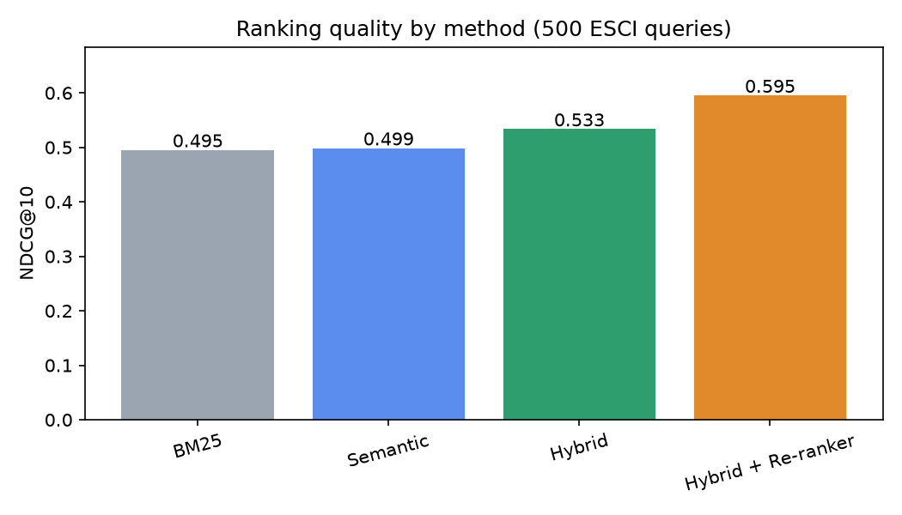
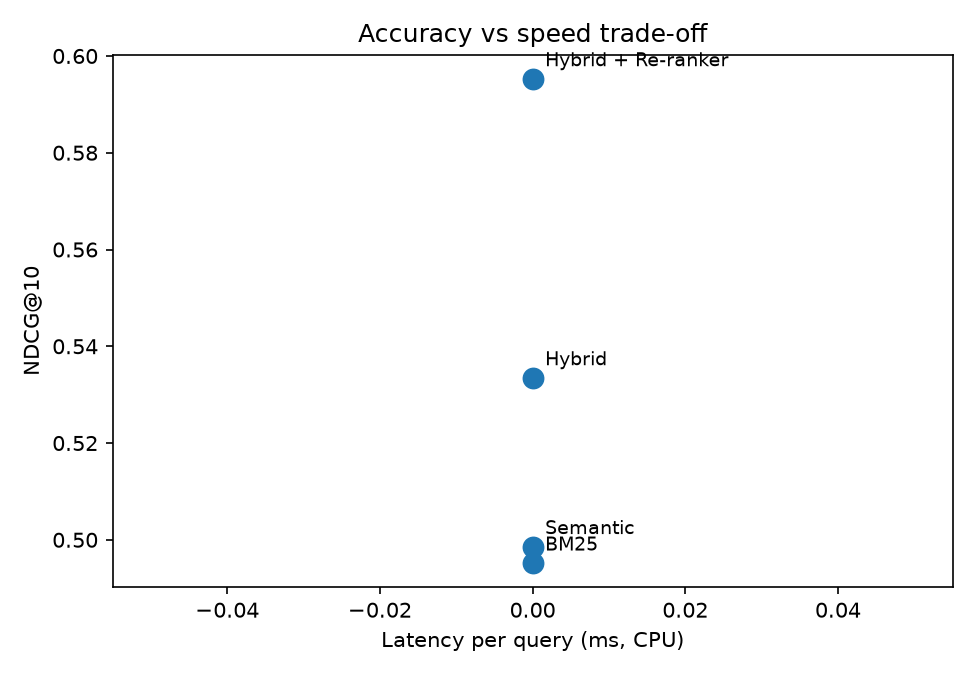
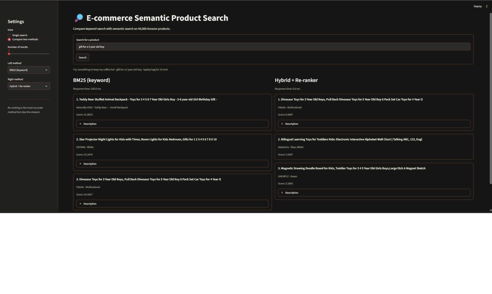

# E-commerce Semantic Product Search

A product search engine that combines keyword search (BM25), semantic search
(sentence embeddings + FAISS) and a cross-encoder re-ranker. It is evaluated
on real shopper queries from the Amazon ESCI dataset.

## Why this project
Keyword search only matches exact words. A shopper typing "something to keep my
coffee hot" will not find a product titled "insulated travel mug". This project
builds and compares four ranking methods to show what each one adds.

## Pipeline
```
Query -> BM25 + Semantic search -> Hybrid fusion (RRF, top 20-50) -> Cross-encoder re-ranker -> Top 10
```

## Dataset
- Amazon Shopping Queries (ESCI) dataset, US English, reduced version
- Corpus: 40,063 products. Evaluation: 500 test queries with E/S/C/I relevance labels
- Relevance gains: Exact = 3, Substitute = 2, Complement = 1, Irrelevant = 0

## Results

| Method | Recall@10 | MRR@10 | NDCG@10 | NDCG vs BM25 |
|---|---|---|---|---|
| BM25 | 0.3362 | 0.7332 | 0.4952 | baseline |
| Semantic | 0.3360 | 0.7456 | 0.4986 | +0.7% |
| Hybrid (RRF) | 0.3673 | 0.7583 | 0.5335 | +7.7% |
| **Hybrid + Re-ranker** | **0.4045** | **0.8103** | **0.5953** | **+20.2%** |



### Key findings
- Semantic search alone is about equal to BM25 here, because product titles
  already contain the words shoppers type.
- Combining them with Reciprocal Rank Fusion gives +7.7% NDCG@10.
- The cross-encoder re-ranker adds a further gain, for +20.2% over BM25.
- The re-ranker improved 218 of 500 queries and hurt 88 (194 about equal). It helped
  on attribute-rich queries such as "entertainment stand for tv up to 90" and hurt
  on very short or noisy ones such as "brick" and "fly argic".
- Re-ranking costs extra latency, so the API offers it as an optional method.

### Notes on evaluation
- A product counts as relevant for Recall and MRR if its label is E or S.
  NDCG uses all four grades.
- Hybrid weights were tuned on a 250-query split and checked on the other 250.
- Models used: `multi-qa-MiniLM-L6-cos-v1` (embeddings) and
  `cross-encoder/ms-marco-MiniLM-L-6-v2` (re-ranker). Neither was trained on
  shopping data.

## Latency (laptop CPU, average of 3 new queries)
Latency was measured through the FastAPI endpoint on a laptop CPU, using a new
query for each request so the cache was not hit. The first request of each method
was discarded as warm-up.

| Method | Latency | NDCG@10 |
|---|---|---|
| BM25 | 187 ms | 0.4952 |
| Semantic | 47 ms | 0.4986 |
| Hybrid | 216 ms | 0.5335 |
| Hybrid + Re-ranker (20 candidates) | ~1.5 s | 0.5953 |



The re-ranker gives the best accuracy but is about 7x slower than hybrid.
A GPU, a smaller model, or caching would reduce this. `rank_bm25` also scores
every document per query, so a proper BM25 engine would be faster.

### Example queries

**"gift for a 5 year old boy"**
- BM25 returned a "50th Birthday Gift, 50 Year Old T-Shirt" at rank 4, because it matched the words "gift" and "year old".
- Semantic and hybrid returned mostly pink, girl-oriented products.
- The re-ranker put dinosaur toys for 5 year old boys at rank 1. One miss remains: a girls' hair chalk set at rank 5.

**"laptop bag for 15 inch"**
- All methods returned relevant bags. The re-ranker only reordered them, which shows
  it helps less on easy queries.

## Demo



Run it locally:
1. Start the API: `uvicorn app.api:app`
2. In a second terminal, start the UI: `streamlit run app/ui.py`


## Project structure
```
src/        bm25_search.py, vector_search.py, hybrid.py, rerank.py, evaluate.py
notebooks/  data exploration, preprocessing, and one notebook per method
app/        FastAPI backend (and Streamlit UI)
docs/       charts used in this README
```

## How to run
```bash
python -m venv venv
venv\Scripts\activate          # Windows
pip install -r requirements.txt
```
1. Download the ESCI parquet files into `data/` (https://github.com/amazon-science/esci-data)
2. Run the notebooks in order (02 to 09) to build the corpus, embeddings and results
3. Start the API: `uvicorn app.api:app`
4. In a second terminal, start the UI: `streamlit run app/ui.py`

## Limitations
- The corpus is a 40k-product sample, not a full catalog
- The re-ranker is a generic model, not fine-tuned on products
- No spell correction yet, so typos hurt results

## Next steps
- Fine-tune the embedding model and re-ranker on the ESCI training split
- Blend hybrid and re-ranker scores instead of replacing the ranking
- Skip re-ranking for very short queries and add spell correction
- Docker deployment and a live demo

## Dataset credit
Amazon Shopping Queries Dataset (ESCI), Reddy et al., 2022.